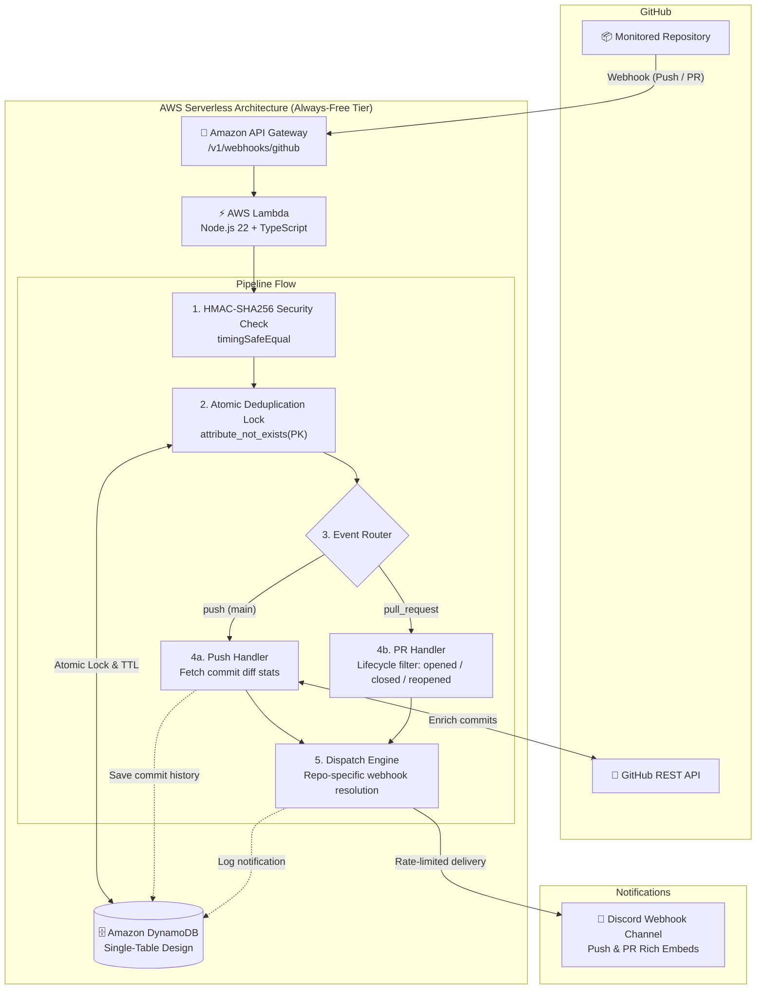

<p align="center">
  
</p>

<p align="center">
  <strong>A Serverless GitHub Automation Bot</strong> that monitors repository commits, pushes & pull requests and broadcasts rich, real-time update notifications to contributor channels (Discord) — built on an <strong>Always-Free AWS Serverless Architecture</strong> ($0/month indefinitely).
</p>

<p align="center">
  <a href="https://github.com/BuggyPratiK/Syncro/actions"></a>
  <a href="https://www.typescriptlang.org/"></a>
  <a href="https://aws.amazon.com/"></a>
  <a href="https://aws.amazon.com/dynamodb/"></a>
  <a href="https://jestjs.io/"></a>
  <a href="https://opensource.org/licenses/MIT"></a>
</p>

---

## Architecture

Syncro runs 100% serverless across permanent AWS Always-Free tier services:



---

## Key Architectural Features

- **Permanent Always-Free Tier**: Powered by AWS Lambda (1M free requests/month forever) and Amazon DynamoDB (25 GB storage + 25 WCU/RCU forever). Runs at **$0/month indefinitely**.
- **High-Signal Push & PR Lifecycle Tracking**: Real-time rich embeds for commits and Pull Request events (`opened`, `reopened`, `closed/merged`) with dynamic base-branch contributor sync commands (`git pull origin <branch>`), diff statistics, and direct review links. Noisy events (synchronize, labels) are filtered to prevent channel spam.
- **Per-Repository Webhook Routing**: Supports multi-tenant delivery where each monitored repository dispatches to its own dedicated Discord webhook URL configured in DynamoDB.
- **Atomic Idempotency & Deduplication**: Prevents duplicate notifications during GitHub webhook retries using conditional DynamoDB `PutItem` (`attribute_not_exists(PK)`). Zero duplicate notifications even under concurrent delivery bursts.
- **Single-Table Design**: All entities (Repository Configs, Delivery Deduplication Records, Commit History, Notification Logs) live in a single DynamoDB table with composite partition and sort keys (`PK` / `SK`).
- **Cryptographic Security**: Every incoming payload is validated using HMAC-SHA256 signatures with constant-time equality comparisons (`crypto.timingSafeEqual`) to prevent timing attack vulnerabilities.
- **Resilient Delivery**: Automatic retry with exponential backoff on HTTP `429 Too Many Requests` respecting Discord's `Retry-After` rate-limit headers.
- **Infrastructure as Code (IaC)**: Fully defined and reproducible using **AWS CDK (TypeScript)**. Production deploys run only through the GitHub Actions Deploy workflow (see [Deploy to AWS](#3-deploy-to-aws)).
- **Comprehensive Test Suite & E2E Layer**: 23 test suites and 175 tests covering **~93% of the codebase**, including an end-to-end integration test layer validating the pipeline from API Gateway -> Lambda -> DynamoDB -> Discord mock.

---

## DynamoDB Single-Table Schema

| Entity | PK | SK | Key Attributes |
|---|---|---|---|
| **Discord Destination** | `DESTINATION#<destination_id>` | `CONFIG` | `destination_id`, `provider` (`discord`), `display_name`, `discord_webhook_url` *(backend only)*, `is_active`, `GSI1PK=TYPE#DESTINATION` |
| **Repository Config** | `REPO#<github_repo_id>` | `CONFIG` | `github_full_name`, `github_url`, `discord_destination_id` *(foreign key)*, `watched_branch`, `is_active`, `GSI1PK=TYPE#REPO` |
| **Delivery Lock** | `DELIVERY#<delivery_id>` | `DELIVERY#<delivery_id>` | `event_type` (`push` \| `pull_request`), `status` (`processing` \| `processed` \| `failed` \| `ignored`), `lease_expires_at`, `attempt_count`, `ttl` (30 days) |
| **Commit Record** | `REPO#<github_repo_id>` | `COMMIT#<sha>` | `short_sha`, `author_name`, `message`, `additions`, `deletions`, `files`, `branch` |
| **Notification Log** | `REPO#<github_repo_id>` | `NOTIF#<delivery_id>#<channel>[#<dest_id>]` | `channel`, `destination_id`, `status` (`sent` \| `failed`), `retry_count`, `error_message` |

---

## Destination Management & Migration

Syncro decouples Discord incoming webhooks into reusable destination entities, enabling multiple repositories to share a single Discord channel without secret duplication.

### Migration from Legacy Configurations

To migrate existing repository items containing direct `discord_webhook_url` attributes into normalized destination entities:

```bash
# 1. Preview changes safely without modifying DynamoDB
npm run migrate:destinations:dry-run

# 2. Apply migration idempotently
npm run migrate:destinations
```

The migration script:
- Reuses existing destinations when multiple repositories share the same webhook URL.
- Retains legacy attributes for seamless zero-downtime backward compatibility.
- Never prints raw webhook secrets or tokens (strictly masked with `[REDACTED]`).
- Is fully idempotent and safe to resume if interrupted.

---

## Getting Started

### Prerequisites

- Node.js 22+ & npm
- AWS CLI configured with active credentials
- A GitHub App created with **Repository: Contents (Read)**, **Pull requests (Read)** & **Metadata (Read)** permissions (subscribed to **Push** and **Pull request** webhook events)
- A Discord Webhook URL for your target channel

### 1. Installation

```bash
git clone https://github.com/BuggyPratiK/Syncro.git
cd Syncro
npm install
```

### 2. Configure Credentials

Run the guided local configuration script to populate `.env.local` (never committed):

```bash
npm run setup:secrets
```

### 3. Deploy to AWS

Production deploys happen **only** through the GitHub Actions **Deploy** workflow (`.github/workflows/deploy.yml`). It runs on pushes to `main`:

1. Open a pull request to `main`. The pull request must pass the `Lint, Type-Check, Test` check and be reviewed before merge.
2. Merging into `main` starts a Deploy run. The run waits for approval on the `production` environment.
3. Approve only a run whose commit is the current head of `main`.
4. After the deploy, verify the deployed commit and its result before merging anything else.

**Safeguards in the workflow:**
- **Serialized deploys.** Runs share the `syncro-production-deploy` concurrency group. A running deploy is never cancelled. At most one run is pending, and a newer run replaces an older pending one.
- **Stale-commit guard.** The run fails if its commit is no longer the head of `main`. It checks twice: before AWS credentials are configured, and again immediately before `cdk deploy`.

The guard is a point-in-time check, **not a lock**. `main` can still move after the last check or while `cdk deploy` runs. **Do not merge into `main` while a Deploy run is waiting, pending or running.**

**Re-running Deploy runs:**
- **Never re-run a Deploy run from a commit that precedes W1** (the change that added the concurrency group and the stale-commit guard). A re-run executes the workflow definition from the run's original commit, so such a run has neither safeguard.
- For a failed deploy, re-run **only the newest eligible post-W1 run**, and only after confirming that its commit matches the current head of `main`.

This is an operating rule. W1 does not technically prevent re-runs of historical runs.

**Local commands are for checks only:**

```bash
npm run lint
npm run type-check
npm test
npm run cdk:synth
npm run cdk:diff   # output can include Lambda environment values: keep it local, never paste or publish it
```

**Prohibited against production:**
- **Local deploys:** `npm run cdk:deploy` / `npx cdk deploy`.
- **`cdk destroy`** (`npm run cdk:destroy`). This is prohibited outright and is not a break-glass operation. Destroying production needs a separate disaster-recovery decision.
- **Direct AWS console or CLI changes** to Lambda, CloudFormation or DynamoDB infrastructure or configuration, except under break-glass.
- **`cdk bootstrap`** as a routine step. Bootstrapping the production account is a separately planned infrastructure operation and needs explicit approval.

**Break-glass:** a deploy or repair outside the Deploy workflow is allowed only if all of the following hold:
- the repository owner explicitly decides on it;
- merges into `main` are paused;
- no Deploy run is waiting, pending or running;
- evidence of what was done is recorded, without secret values.

> These are operating rules, not IAM enforcement. An AWS administrator can still bypass the workflow technically. A least-privilege deployment identity with OIDC is planned future hardening.

The stack outputs, including your live API Gateway webhook endpoint, appear in the Deploy run log:
```text
Outputs:
SyncroStack.WebhookUrl = https://<api-id>.execute-api.<region>.amazonaws.com/v1/webhooks/github
SyncroStack.HealthUrl = https://<api-id>.execute-api.<region>.amazonaws.com/v1/health
```

### 4. Register a Repository to Watch

```bash
npm run seed
```

Enter your repository's numeric GitHub ID, full name (`owner/repo`), and branch (`main`).

---

## Testing & Code Quality

```bash
# Run unit tests
npm test

# Run tests with code coverage report
npm run test:coverage

# Run TypeScript type-checker across source and infra
npm run type-check

# Run ESLint
npm run lint
```

---

## License

This project is licensed under the MIT License.